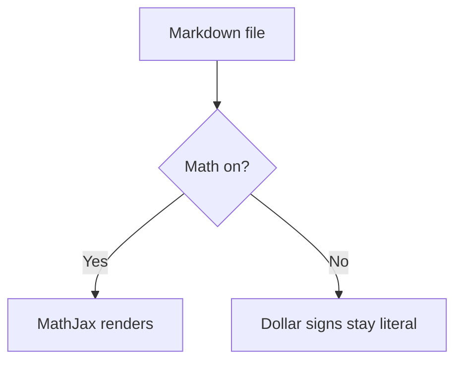

# Feature test

A paragraph with **bold**, *italic*, `code`, a [link](https://example.com),
:smile: emoji, ==a highlight==, a [[Wikilink]], footnote[^1], and
~~strikethrough~~.

## Tasks and tables

- [x] Done
- [ ] Not done

| A | B |
| - | - |
| 1 | 2 |

## Alert

> [!WARNING]
> Alerts render as callouts, this one included.

## Definition list

MarkyQL
: A Quick Look extension with no nags.

## Code

```objc
#import <Foundation/Foundation.h>
int main(void) { NSLog(@"hello"); }
```

## Math (only renders with the Math extension ON)

Inline $E = mc^2$ and a display block:

$$
\int_0^1 x^2 \, dx = \frac{1}{3}
$$

## Mermaid



[^1]: Footnotes work too.
